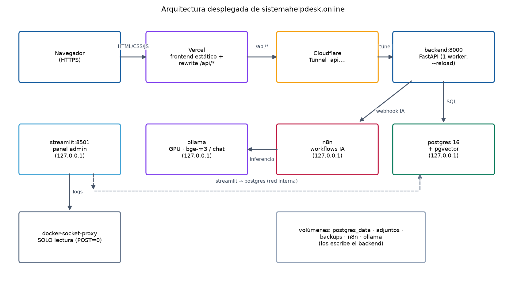
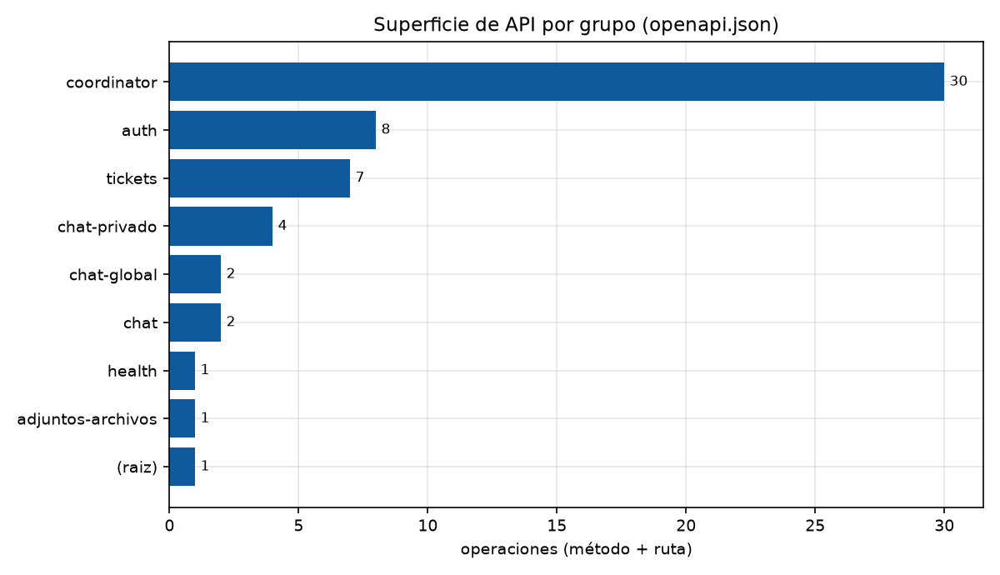
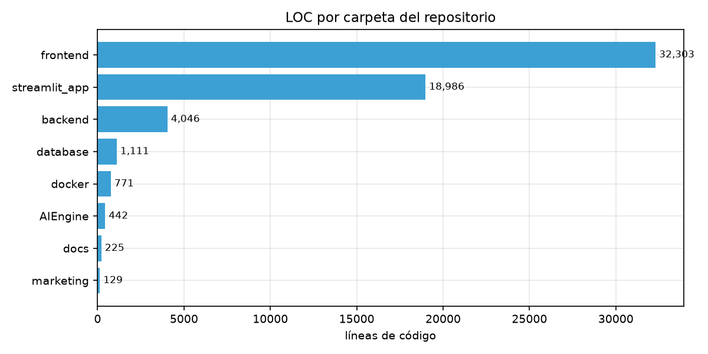

# Informe de arquitectura — sistemahelpdesk.online

**Fecha**: 2026-10-15 · **Fuentes**: `docker/docker-compose.yml`, código fuente,
`test/datos/openapi.json`, `test/datos/metricas.json`, inspección de contenedores.

---

## 1. Despliegue observado

### Bordes públicos

| Capa | Servicio | Detalle |
| --- | --- | --- |
| DNS/CDN web | **Vercel** (`www` → CNAME `vercel-dns-017.com`) | HTML/CSS/JS estáticos, caché `HIT`, cabeceras de seguridad en `vercel.json`; **apex** apunta a `216.198.79.1` y redirige 308 → `www` |
| Proxy de API | **Cloudflare Tunnel** (`api.…` → IPs Cloudflare 104.21/172.67) | Conector `helpdesk-cloudflared` con token; ingress público `api.sistemahelpdesk.online → http://backend:8000` |
| Rewrite | `vercel.json` | `/api/:path* → https://api.sistemahelpdesk.online/api/:path*` → **mismo origen en el navegador, sin CORS** |

### Servicios Docker (red `shelpdeskmicrosoft_helpdesk-network`)

| Contenedor | Imagen/build | Puerto expuesto | Salud/reinicio | Rol |
| --- | --- | --- | --- | --- |
| `helpdesk-db` | `pgvector/pgvector:pg16` | `127.0.0.1:5432` ✅ | `pg_isready` 10 s, `healthy` | `helpdesk_db` + `n8n_db`, pgvector (HNSW) |
| `ollama` | `ollama/ollama:0.33.3` | `127.0.0.1:11434` ✅ | `restart unless-stopped` | IA local en GPU (`OLLAMA_KEEP_ALIVE=30m`, `bge-m3`) |
| `helpdesk-backend` | build `../backend` (Python 3.12-slim) | **`0.0.0.0:8000`** ⚠️ | `GET /api/health` 30 s, `healthy` | API FastAPI (ver hallazgo [S2](seguridad.md)) |
| `helpdesk-streamlit` | build `streamlit_app/Dockerfile` | `127.0.0.1:8501` ✅ | `restart unless-stopped` | Panel de analítica/admin local |
| `n8n` | `n8nio/n8n:2.37.10` | `127.0.0.1:5678` ✅ | `restart unless-stopped` | Workflows: clasificación IA y notificaciones |
| `helpdesk-socket-proxy` | `tecnativa/docker-socket-proxy:v0.5.0` | ninguno | `POST=0` | Socket Docker de **solo lectura** (logs) |
| `helpdesk-cloudflared` | `cloudflare/cloudflared:2026.9.0` | ninguno | `restart unless-stopped` | Túnel (token en `.env`) |

**Volúmenes**: `postgres_data`, `ollama_data`, `n8n_data`, `db_backups`,
`adjuntos_data`. **Bind mounts**: `../backend:/app` y `../streamlit_app:/app`
(desarrollo con auto-reload).

### Endpoints de la API

47 rutas / **56 operaciones** (GET 26, POST 25, PATCH 3, DELETE 2); 49 con
seguridad declarada. Grupos: `coordinator` 30 · `auth` 8 · `tickets` 7 ·
`chat-privado` 4 · `chat` 2 · `chat-global` 2 · adjuntos/health/raíz 3.

---

## 2. Flujos principales

| Flujo | Recorrido |
| --- | --- |
| **Login (+MFA)** | `login.html` → Vercel rewrite → `POST /api/auth/login` → bcrypt + rate-limit (5/ email, 200/IP por Vercel) → JWT 24 h; admin/coordi con TOTP (`pyotp`) |
| **Creación de ticket** | `POST /api/tickets` (solo solicitante) → notificación `fire-and-forget` a n8n → workflow clasifica con Ollama → callback `POST /api/tickets/{id}/ai-analysis` con `X-API-Key` → índice RAG (embedding `bge-m3` → pgvector) |
| **Chat** | Global (cualquier rol), IA (Ollama vía n8n) y privado (solo personal interno); límites `SpamGuard` 5 ráfagas/10 s |
| **Adjuntos** | Upload por streaming (20 MB, magic bytes) → UUID en disco → servido solo con sesión + ownership (`nosniff`, `no-store`) |
| **Respaldos** | `pg_dump/pg_restore` desde el backend al volumen `db_backups` (retención 30 d / mín. 5), disparados desde el panel admin |
| **Panel admin** | Streamlit en `127.0.0.1:8501` + logs vía `docker-socket-proxy` (solo lectura) |

---

## 3. Métricas de código

| Carpeta | Ficheros | LOC | Comentario |
| --- | ---: | ---: | --- |
| `frontend/` | 33 | 32 303 | 8 HTML + 13 JS + 8 CSS (**14 930** LOC de web, 592 KB) |
| `streamlit_app/` | 12 | 18 986 | Panel admin: el módulo más grande en LOC por fichero |
| `backend/` | 17 | 4 046 | 13 `.py` → **3 915 LOC**, 55 decoradores de ruta |
| `database/` | 14 | 1 111 | Esquema + 10 migraciones numeradas (`schema_migrations`) |
| `docker/` | 5 | 771 | compose dev/prod + Caddyfile |
| `AIEngine/` | 3 | 442 | Plantillas de workflows n8n |
| `docs/` `marketing/` `.github/` | 7 | 397 | Documentación, marketing, CI |
| **Total** | ~95 | **~58 000** | |

### Calidad del código (lectura estática + pruebas)

| Aspecto | Evaluación |
| --- | --- |
| Modularidad del backend | ✅ Un router por dominio (`auth`, `tickets`, `chat_*`, `coordinator`, `adjuntos`, `docker_admin`, `audit`, `ratelimit`, `embeddings`) con contratos claros |
| Control de acceso | ✅ `usuario_actual` revalida rol/estado en BD en cada endpoint; ownership por rol verificado en tickets, adjuntos y chat privado |
| Validación | ✅ Pydantic + `text("... :x")` parametrizado en todas las consultas |
| Migraciones | ✅ 10 migraciones numeradas aplicadas con control de versiones de esquema |
| CI | ⚠️ `ruff` solo errores (E9/F63/F7/F82) + compilación; Dependabot semanal. **No hay tests unitarios ni de integración** en el repositorio |
| Consistencia frontend/backend | ✅ Contratos compartidos vía `openapi.json`; `config.js` centraliza la URL de API |
| Deuda técnica | ⚠️ `--reload` en producción; `streamlit_app` casi 19 k LOC sin tests; lógica de negocio concentrada en `coordinator.py` (30 operaciones); sin capa de servicios intermedia |

---

## 4. Riesgos y deuda asociada

| # | Riesgo | Origen | Mitigación |
| --- | --- | --- | --- |
| A1 | Punto único de fallo (host + disco + GPU) | Compose con 1 instancia por rol | Respaldos fuera del host + restauración probada (ver [escalabilidad E-g](escalabilidad.md)) |
| A2 | API visible para la LAN/Tailscale | Puerto `8000` en `0.0.0.0` | [Seguridad S2](seguridad.md) |
| A3 | Superficie de ataque ampliada por Swagger público | `FastAPI` con docs por defecto | [Seguridad S1](seguridad.md) |
| A4 | Regresiones no detectadas | Ausencia de tests + CI limitado | Añadir `pytest` con pruebas de auth/ownership (los bugs históricos fueron de ownership) |
| A5 | Acoplamiento del túnel a un token en `.env` | `cloudflared` con token remoto | Rotación documentada; alerta de salud del túnel |
| A6 | Estado de rate-limit efímero | `ratelimit.py` en memoria | Redis antes de escalar a N workers |
| A7 | Backend con bind mount en producción | Compose "DESARROLLO" (el prod usa `docker-compose.prod.yml` + Caddy) | Asegurar el despliegue real usa el compose de producción sin binds |

---

## 5. Veredicto

Arquitectura **clara, por dominios y bien segmentada** (borde estático en
Vercel, API por túnel, servicios internos aislados, socket de Docker solo
lectura, IA local). Los puntos fuertes son el control de acceso por rol, las
migraciones versionadas y el aislamiento de servicios. Las debilidades son
operativas: **instancia única con `--reload`, sin tests automatizados, límites
en memoria y un puerto de backend demasiado abierto** — todos corregibles con
cambios pequeños (ver planes en los informes de
[seguridad](seguridad.md) y [escalabilidad](escalabilidad.md)).
