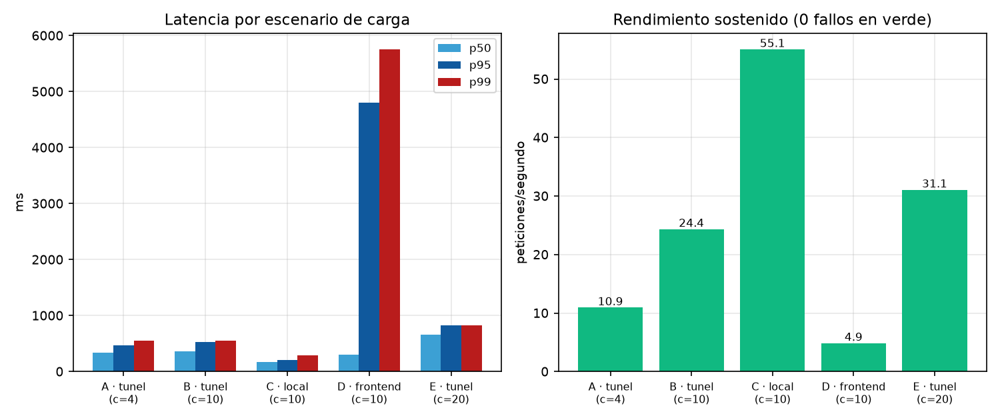
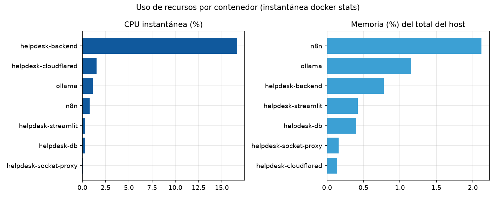

# Informe de escalabilidad — sistemahelpdesk.online

**Fecha**: 2026-10-15 · **Método**: 5 escenarios de concurrencia sobre
`GET /api/health` (túnel y local) y `GET /login.html` (CDN), sin escrituras.
**Datos**: [`../datos/carga_resumen.csv`](../datos/carga_resumen.csv),
[`../datos/carga.csv`](../datos/carga.csv),
[`../datos/docker_stats.csv`](../datos/docker_stats.csv).
**Gráficos**:  ·


---

## 1. Resultados de carga

| Escenario | Conc. | Peticiones | Fallos | req/s | p50 (ms) | p95 (ms) | p99 (ms) |
| --- | ---: | ---: | ---: | ---: | ---: | ---: | ---: |
| A · túnel `/api/health` | 4 | 60 | **0** | 10,95 | 342 | 471 | 547 |
| B · túnel `/api/health` | 10 | 100 | **0** | 24,36 | 366 | 525 | 547 |
| C · **local** `/api/health` | 10 | 100 | **0** | **55,08** | 174 | 209 | 290 |
| D · frontend `login.html` | 10 | 100 | **0** | 4,88 | 304 | **4 800** | 5 755 |
| E · túnel `/api/health` | 20 | 100 | **0** | 31,08 | 659 | 821 | 828 |


### Interpretación

- **Cero errores en todas las condiciones probadas**: ni timeouts ni 5xx.
- **El cuello de botella es el worker único**: al pasar de 10 a 20 conexiones
  simultáneas por el túnel, el rendimiento sube poco (24 → 31 req/s) mientras
  el p50 se duplica (366 → 659 ms). Eso es la cola de un proceso que atiende
  de a uno: `uvicorn --host 0.0.0.0 --port 8000 --reload` **sin `--workers`**.
- **La comparación local/túnel confirma que la app no es el límite**:
  localmente se hacen 55 req/s con p50 de 174 ms; el techo observado por el
  túnel (~31 req/s) lo impone el RTT hacia el PoP, no el backend.
- **Ojo: `/api/health` es un endpoint caro** (hace ping a PostgreSQL, Ollama
  y n8n en cada llamada). Los 55 req/s locales equivalen a ~165 pings/s a
  esos tres servicios; los endpoints normales de negocio deberían ser
  considerablemente más rápidos.
- **Escenario D (CDN) muestra una cola en el cliente/edge**: con 10 hilos
  repitiendo la misma petición estática, el p95 salta a 4,8 s (y 17,6 s en la
  primera pasada) manteniendo 0 errores. No refleja la carga real de un
  usuario (su navegador abre ~6 conexiones y el asset se cachea), pero indica
  que no conviene apoyar lógica de servidor en el frontend estático.

---

## 2. Recursos del sistema (instantánea `docker stats`)


| Contenedor | CPU | Memoria | Nota |
| --- | ---: | ---: | --- |
| helpdesk-backend | 16,6 % | 124,6 MiB (0,8 %) | Proceso Python con `--reload` |
| n8n | 0,8 % | 337,6 MiB (2,1 %) | Mayor consumidor de RAM |
| ollama | 1,1 % | 182,8 MiB (1,2 %) | + 4,1 GB de I/O de bloque = modelo cargado (GPU) |
| helpdesk-db | 0,3 % | 63,7 MiB | pgvector/pg16 |
| helpdesk-streamlit | 0,3 % | 66,4 MiB | Panel admin local |
| helpdesk-cloudflared | 1,5 % | 22,4 MiB | Túnel con I/O 14,1 MB/13,9 MB |
| helpdesk-socket-proxy | 0,03 % | 25,1 MiB | SOLO lectura (`POST=0`) |

**Host: 15,58 GiB RAM, uso total < 6 %**. Hay holgura enorme para crecer
dentro de esta misma máquina (más workers, más conexiones, modelos más
grandes).

---

## 3. Cuellos de botella estructurales

| # | Elemento | Evidencia | Consecuencia |
| --- | --- | --- | --- |
| E1 | **Un solo worker uvicorn** (`--reload`, sin `--workers`) | `backend/Dockerfile` | Techo ~31 req/s por el túnel; la latencia crece lineal con la cola (E) |
| E2 | **Rate-limits en memoria** (`SlidingWindowLimiter`, `SpamGuard`) | `ratelimit.py` | 1) Se pierden al reiniciar; 2) con N workers cada uno tendría su propio contador (×N capacidad efectiva); 3) impide réplicas horizontales |
| E3 | **Pool de conexiones por defecto** | `create_async_engine(DATABASE_URL)` sin `pool_size` | SQLAlchemy/asyncpg: 5 + 10 de desborde = 15 conexiones; con más workers habría que dimensionarlo explícitamente |
| E4 | **Healthcheck costoso** | `main.py` hace ping a DB + Ollama + n8n | Infla la métrica de carga y añade latencia de terceros a cada sondeo (y al propio `healthcheck` de Docker) |
| E5 | **Instancia única por servicio** | Compose: 1 contenedor por rol, sin réplicas ni balanceador | Un único host = punto único de fallo; sin auto-escalado ni failover |
| E6 | **IA sin cola persistente** | Notificación a n8n "fire-and-forget" + callback con `X-API-Key` | Un pico de tickets puede disparar muchas llamadas a Ollama/GPU sin control de concurrencia (no probado aquí por ser destructivo) |
| E7 | **Backups locales** | `pg_dump` a volumen `db_backups` en el mismo host | Sin copia fuera de máquina: RPO afectado por un desastre del host |

---

## 4. Capacidad estimada y recomendaciones

**Capacidad observada** (única máquina actual, health endpoint):

- Con la arquitectura presente: **~25–31 req/s sostenidos** por el túnel y
  **~55 req/s** en local con concurrencia 10–20 y 0 fallos; p95 < 830 ms
  (túnel). Para una mesa de ayuda interna (decenas de usuarios simultáneos,
  cada uno con pocas peticiones/segundo) es **ampliamente suficiente**.

| # | Acción | Impacto | Esfuerzo |
| --- | --- | --- | --- |
| E-a | Quitar `--reload` y pasar a `--workers 4` (≈ nº CPU lógicas / 2) | ×3–4 capacidad efectiva | Bajo |
| E-b | Migrar los límites de tasa a **Redis** (o a PostgreSQL) | Habilita E-a sin perder rate-limit y permite réplicas | Medio |
| E-c | Cache corto del health (p. ej. 5 s) o health liviano + check profundo separado | −latencia en sondeos y en la carga medida | Bajo |
| E-d | Dimensionar `pool_size/max_overflow` explícitamente según workers | Evita agotar conexiones con N workers | Bajo |
| E-e | Publicar el backend en `127.0.0.1` (ver [seguridad S2](seguridad.md)) | Todo el tráfico pasa por Cloudflare (WAF + rate-limit de borde) | Bajo |
| E-f | Cola/semáforo para clasificación IA (máx. X inferencias simultáneas en Ollama) | Protege la GPU ante ráfagas de tickets | Medio |
| E-g | Copia de respaldos fuera del host (rclone/S3 con retención) | RPO real ante desastre | Medio |
| E-h | Monitorización (métricas de Prometheus + alertas de latencia/error) | Detectar saturación antes que los usuarios | Medio |

---

## 5. Reproducción

```powershell
python test/scripts/carga.py           # 5 escenarios, ~3 min
docker stats --no-stream               # instantánea de recursos
```

**Notas éticas**: solo se usó `GET /api/health` y un HTML estático; la
duración total fue < 4 minutos y no se generaron escrituras. Repite las
mediciones en horario laboral para capturar la carga real.
