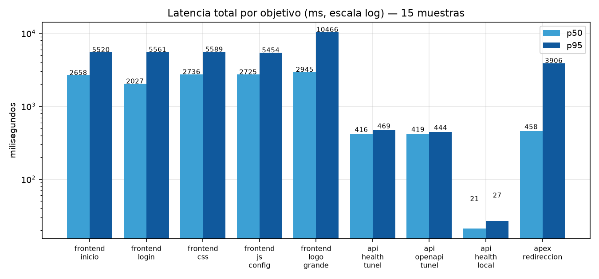
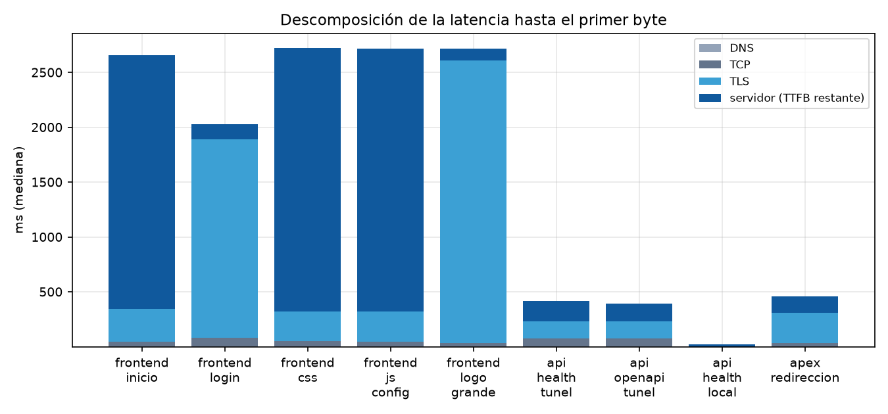

# Informe de rendimiento — sistemahelpdesk.online

**Fecha**: 2026-10-15 · **Método**: 15 muestras secuenciales por objetivo con
`curl.exe` (HTTP/2 activo), 120 ms de separación, timeout 25 s.
**Datos**: [`../datos/rendimiento.csv`](../datos/rendimiento.csv) (muestra a muestra),
[`../datos/rendimiento_resumen.csv`](../datos/rendimiento_resumen.csv).
**Gráficos**: 
· 

> Un solo punto de medición (Wi-Fi en `192.168.1.10`); el PoP de Cloudflare
> utilizado fue **Miami (MIA)** y el de Vercel **iad1** (Washington). Los
> valores son comparables **entre objetivos**, no entre regiones.

---

## 1. Resultados

| Objetivo | Bytes | p50 (ms) | p95 (ms) | TTFB p50 (ms) | Fallos |
| --- | ---: | ---: | ---: | ---: | ---: |
| Frontend `www/` (inicio) | 456 | **2 658** | 5 520 | 2 658 | 0/15 |
| Frontend `login.html` | 5 846 | **2 027** | 5 561 | 2 026 | 0/15 |
| Frontend `styles/login.css` | 18 850 | **2 736** | 5 589 | 2 721 | 0/15 |
| Frontend `js/config.js` | 2 621 | **2 725** | 5 454 | 2 717 | 0/15 |
| Frontend `logohelpdesk.png` | 667 337 | **2 945** | 10 466 | 2 720 | 0/15 |
| API `/api/health` (túnel) | 72 | **416** | 469 | 416 | 0/15 |
| API `/openapi.json` (túnel) | 34 087 | **419** | 444 | 391 | 0/15 |
| Backend **local** `127.0.0.1:8000/api/health` | 72 | **21** | 27 | 21 | 0/15 |
| `sistemahelpdesk.online/` (apex, 308 → www) | — | 458 | 3 906 | 457 | **4/15** |


---

## 2. Lectura de los datos

1. **La latencia del frontend está dominada por la red, no por Vercel.**
   En `frontend_inicio`, el TTFB p50 (2 658 ms) es **idéntico** al total: la
   descarga del HTML (456 B) es instantánea; el tiempo se va en DNS + TCP +
   TLS + RTT hasta el PoP de Vercel. La descomposición lo confirma:

   

2. **La API vía túnel es ~20× más rápida que la ida y vuelta al frontend**:
   416 ms frente a 2,0–2,9 s. `api.` termina en Cloudflare (PoP MIA) y el
   túnel (`cloudflared`) ya mantiene la conexión con el origen, así que solo
   se pagan 1–2 RTT extra.
3. **El túnel cuesta ~395 ms sobre el backend local**: 416 ms (túnel) − 21 ms
   (local) ≈ 395 ms = RTT cliente→PoP MIA + PoP→origen. Es el precio
   esperado de salir a Internet; **dentro de la misma red el backend responde
   en 21 ms**.
4. **El apex es inestable**: 4 de 15 peticiones a `https://sistemahelpdesk.online/`
   terminaron con error de conexión/timeout (p95 3,9 s), mientras que probes
   sueltos posteriores dieron 308 en 0,33–0,44 s. El apex apunta a IPs
   sueltas de Vercel (`216.198.79.1`) mientras `www` usa el CNAME
   `vercel-dns-017.com`; conviene unificar (redirigir apex → www o mover el
   apex al mismo CNAME gestionado).
5. **`logohelpdesk.png` (667 KB) es el peor activo**: p95 10,5 s para una
   imagen decorativa del login. Es ~150× el tamaño del HTML de login.
6. **La caché funciona**: `X-Vercel-Cache: HIT` con `Age: 8 085` s y
   `ETag` presente; `config.js` se sirve con `Cache-Control: no-cache`
   (declarado en `vercel.json`) para poder cambiar el destino de la API sin
   caché intermedia — decisión correcta.

---

## 3. Recomendaciones

| # | Acción | Esperado | Esfuerzo |
| --- | --- | --- | --- |
| R1 | Comprimir/redimensionar `logohelpdesk.png` (WebP/AVIF ~50–80 KB, tamaño real mostrado) | p95 del login de 10,5 s a < 2 s en esta misma medición | Bajo |
| R2 | Estabilizar el **apex** (unificar con el CNAME de `www` o redirigir en DNS, no solo con 308) | 0/15 fallos y p95 < 1 s | Bajo |
| R3 | Precarga de recursos críticos del login (`dns-prefetch`/`preconnect` a cdnjs) | −1 RTT en el primer CSS/JS | Bajo |
| R4 | Añadir **HSTS y cabeceras de seguridad** en `api.` (ver [seguridad S5](seguridad.md)) | Reduce el tiempo del primer contacto HTTPS | Bajo |
| R5 | Si se esperan usuarios fuera de Norteamérica, medir con RUM (CrUX/PageSpeed) o colocar el origen más cerca del público | El p50 del frontend baja al RTT real del usuario | Medio |
| R6 | Mantener el patrón actual de rewrite Vercel → túnel (sin CORS y con caché CDN) | ya en vigor | — |

---

## 4. Reproducción

```powershell
python test/scripts/rendimiento.py 15   # 15 muestras × 9 objetivos
```

Columnas por muestra: `dns_ms, tcp_ms, tls_ms, ttfb_ms, total_ms, status,
bytes, velocidad_bps, ssl_ok, conexiones`.
