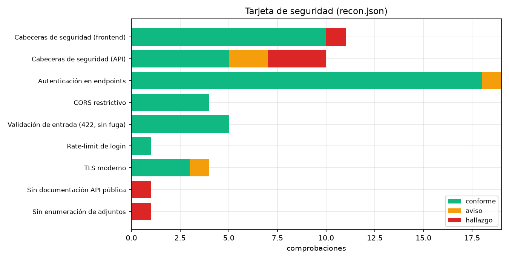

# Informe de seguridad — sistemahelpdesk.online

**Fecha**: 2026-10-15 · **Objetivos**: `https://www.sistemahelpdesk.online` (Vercel),
`https://api.sistemahelpdesk.online` (Cloudflare Tunnel → backend FastAPI).
**Datos**: [`../datos/recon.json`](../datos/recon.json),
[`../datos/tls.json`](../datos/tls.json), [`../datos/endpoints.csv`](../datos/endpoints.csv).
**Gráfico**: 

Pruebas no destructivas de solo lectura (ver límites en el
[README](../README.md#metodología-y-límites)).

---

## 1. Hallazgos

### Medios

| ID | Hallazgo | Evidencia | Impacto | Recomendación |
| --- | --- | --- | --- | --- |
| S1 | **API de documentación pública**: `/docs` (Swagger), `/redoc` y `/openapi.json` responden **200** sin autenticación (34 087 bytes, 47 rutas / 56 operaciones) | `curl` → 200/200/200 | Publica el inventario completo de la superficie de ataque (rutas, modelos, `X-API-Key` en el callback IA), lo que acelera cualquier exploración | Deshabilitar en producción: `FastAPI(docs_url=None, redoc_url=None, openapi_url=None)` o servirlos solo cuando `DEBUG=1` |
| S2 | **Backend accesible fuera de Cloudflare**: `:8000` está publicado en `0.0.0.0` y responde **200** desde `192.168.1.10` (LAN) y `100.120.32.64` (Tailscale) | `curl http://192.168.1.10:8000/api/health → 200 (20 ms)`; `docker ps` → `0.0.0.0:8000->8000/tcp` | Cualquier equipo de la LAN/tailnet llega a la API **sin WAF, sin rate-limit de borde ni geobloqueo**; un atacante en la red local puede saltarse controles de Cloudflare | Publicar como el resto: `- "127.0.0.1:8000:8000"` (cloudflared sigue llegando por la red interna `backend:8000`) |
| S3 | **`uvicorn --reload` en la imagen de producción** | `backend/Dockerfile` → `CMD ["uvicorn", "main:app", ..., "--reload"]` | El watcher vigila ficheros (sobrecarga) y cualquier escritura recarga el proceso en caliente; en un contenedor con bind mount permite recargas no deseadas | Quitar `--reload` en la imagen; usar `--workers N` y un watcher solo en desarrollo |

### Bajos

| ID | Hallazgo | Evidencia | Impacto | Recomendación |
| --- | --- | --- | --- | --- |
| S4 | **Enumeración de adjuntos sin credenciales válidas**: la autenticación se aplica *después* de la consulta a la BD | `adjuntos.py:234-241` (SELECT) → `adjuntos.py:243` (`_usuario_actual`). Prueba: nombre real `b37ab…png` con token inválido → **401**; nombre inexistente con formato válido → **404**; sin cabecera → 401 | Permite confirmar si un nombre de archivo existe sin sesión válida (nombres de 32 hex = UUID, poco enumerables, pero es un fallo de orden) | Mover `await _usuario_actual(db, token)` **antes** del SELECT |
| S5 | **La API no envía cabeceras de seguridad** (ni HSTS): las respuestas de `api.` solo traen `Server: cloudflare`, `CF-Cache-Status`, `CF-RAY` | `recon.json → cabeceras` | Sin HSTS en el subdominio API, un primer contacto HTTP podría ser objeto de downgrade/SSL-stripping (el dominio raíz sí lo sirve) | Activar HSTS, `X-Content-Type-Options`, `X-Frame-Options` y `Permissions-Policy` en Cloudflare (Response Header Transform) |
| S6 | **Orden de validación vs autenticación**: `GET /api/coordinator/rag` con token inválido devuelve **422** (faltan parámetros) en lugar de 401 | `recon.json → auth` | El error distingue "token inválido" de "parámetros ausentes" antes de autenticar; permite sondear el contrato del endpoint | Añadir la dependencia de autenticación antes de las de validación de query |
| S7 | **`GET /api/health` público** devuelve el estado interno (`database/ollama/n8n`) | `{"status":"healthy","checks":{...}}` | Fuga menor de información de infraestructura; útil para confirmar si IA/n8n están caídos | Mantener solo `{"status":"ok"}` público y el detalle tras autenticación |

### Informativos

| ID | Hallazgo | Detalle |
| --- | --- | --- |
| S8 | Certificados de borde Cloudflare con caducidad 3-dic-2026 (`www`/apex, 49 días) y 10-dic-2026 (`api`, 55 días) | Cloudflare los renueva automáticamente; se anota por si se cambia el modo de SSL (Universal → Full/strict con cert propio) |
| S9 | Token JWT con **24 h** de vigencia (`ACCESS_TOKEN_EXPIRE_MINUTES = 60*24`) sin refresh ni rotación; en el web vive en `localStorage` | Mitigado por CSP estricta (sin scripts de terceros salvo cdnjs) y por `frame-ancestors 'none'`; valorar 15–30 min + refresh si se endurece |
| S10 | `GET /api/chat/health` responde 200 sin token | Es un healthcheck por diseño; anotado para que no se confunda con un endpoint abierto |
| S11 | Ausentes `Cross-Origin-Opener-Policy` y `Cross-Origin-Resource-Policy` en el frontend | Mejoras opcionales; la CSP ya fija `frame-ancestors 'none'` |

---

## 2. Controles verificados y conformes

| Control | Resultado | Detalle |
| --- | --- | --- |
| TLS moderno | ✅ | TLS 1.3 en los 3 dominios (`TLS_AES_128/256_GCM_SHA256/384`); TLS 1.0 y 1.1 **rechazados**; TLS 1.2 aceptado (aceptable) |
| HSTS (frontend) | ✅ | `max-age=31536000; includeSubDomains` en todas las respuestas de Vercel |
| CSP | ✅ | `default-src 'self'` + `script-src 'self' https://cdnjs.cloudflare.com` + `style-src 'unsafe-inline'` + `frame-ancestors 'none'` + `base-uri 'self'` + `object-src 'none'` |
| Clickjacking | ✅ | `X-Frame-Options: DENY` + `frame-ancestors 'none'` |
| MIME sniffing | ✅ | `X-Content-Type-Options: nosniff` |
| Fuga de referencias | ✅ | `Referrer-Policy: no-referrer` |
| Permisos de dispositivo | ✅ | `Permissions-Policy: geolocation=(), microphone=(), camera=(), payment=(), usb=()` |
| CORS | ✅ | Solo refleja el origen legítimo (`https://www.sistemahelpdesk.online`); con `evil.example`, `null` y `sistemahelpdesk.online.evil.com` **no hay `Access-Control-Allow-Origin`**; con credenciales activas (`ACAC: true`) la política es estrictamente necesaria |
| Autenticación en endpoints | ✅ (18/19) | Todos los GET protegidos probados devuelven **401** con y sin token: `/api/tickets`, `/api/auth/me`, `/api/chat-global`, `/api/chat-privado/*`, `/api/coordinator/*` (usuarios, estadísticas, respaldos, logs, BD, agentes, SLA, IA, n8n), `/api/tickets/{id}`, adjuntos |
| Rate-limit de login | ✅ | 5 intentos fallidos → **429** en el 6.º (`LOGIN_MAX_POR_EMAIL=5`); además límite por IP (10 por defecto, 200 por Vercel), registro 5/IP, MFA con intentos propios y bloqueo por fallos (`LOGIN_MAX_FALLOS=5`) |
| Validación de entrada | ✅ | JSON inválido, `{}` incompleto, SQLi en email y payload de 9 KB → **422** de Pydantic, **sin traceback**, sin errores SQL, sin reflejo de XSS |
| SQL parametrizado | ✅ | Todas las consultas usan `text("... :x")` con parámetros; ninguna inyección observada en las pruebas |
| Ownership por rol | ✅ (código) | `usuario_actual` revalida contra la BD; tickets/adjuntos/chat verifican pertenencia en cada endpoint |
| Adjuntos endurecidos | ✅ | UUID en disco, regex estricta, magic bytes, 20 MB máx., servido solo autenticado, `nosniff` + `no-store` |
| Docker socket | ✅ | `docker-socket-proxy` con `POST=0` (solo lectura); backend/streamlit no montan el socket |
| Servicios internos | ⚠️ (ver S2) | `postgres`, `n8n`, `ollama`, `streamlit` publicados solo en `127.0.0.1` — solo el backend (`8000`) queda en `0.0.0.0` |
| Secretos | ✅ | Claves por variables de entorno (`.env` gitignored); `JWT_SECRET_KEY`, `AI_CALLBACK_KEY`, `N8N_API_KEY` referenciadas como `${VAR}` en el compose |
| Dependencias | ✅ | Pinning razonable en `requirements.txt`, nota de CVE corregida (`python-jose>=3.4.0`), `bcrypt <4.1` por compatibilidad, Dependabot semanal |
| Exposición de ficheros sensibles | ✅ | `/.env`, `/.git/config`, `/.DS_Store`, `/backup.sql`, `/docker-compose.yml`, `/server-status`, `/phpmyadmin` → **404** en frontend y API |

---

## 3. Plan de remediación priorizado

1. **S2** – Cambiar el publish del backend a `127.0.0.1:8000:8000` y verificar
   que el túnel sigue operativo (`cloudflared` usa `backend:8000` por la red
   interna, no el puerto publicado).
2. **S1** – Deshabilitar `docs/redoc/openapi` en producción.
3. **S3** – Quitar `--reload` de la imagen y reemplazar por
   `--workers` (ver [escalabilidad](escalabilidad.md)).
4. **S4** – Mover `_usuario_actual` antes del SELECT de adjuntos (1 línea).
5. **S5** – Añadir cabeceras de seguridad + HSTS para `api.` en Cloudflare.
6. **S6/S7** – Reordenar dependencias y reducir el detalle del health público.

---

## 4. Detalle de pruebas ejecutadas

| Prueba | Peticiones | Resultado |
| --- | --- | --- |
| Cabeceras de seguridad (9 URLs) | 9 | Frontend completo; API sin cabeceras propias |
| Exposición de rutas (22 rutas × 2 orígenes) | 44 | 9 respuestas ≠ 404, todas esperadas (health 200 / coordinator 401 / docs 200) |
| Autenticación (19 GET × 2 variantes) | 38 | 18/19 correctos; S6 y S10 en los apuntes |
| CORS (4 orígenes × GET + preflight) | 8 | Solo origen legítimo reflejado |
| Validación (JSON, SQLi, vacío, payload 9 KB, XSS en query) | 5 | 422/401 limpios, sin fugas |
| Rate-limit (logins fallidos) | 6 | 429 al 6.º intento → cortado |
| Enumeración de adjuntos | 4 | 401 vs 404 confirmado (S4) |
| TLS (3 dominios + 4 versiones) | 7 | 1.3 activo; 1.0/1.1 rechazados |
| Exposición del puerto 8000 (LAN/Tailscale/WSL) | 3 | 200 en los tres (S2) |
